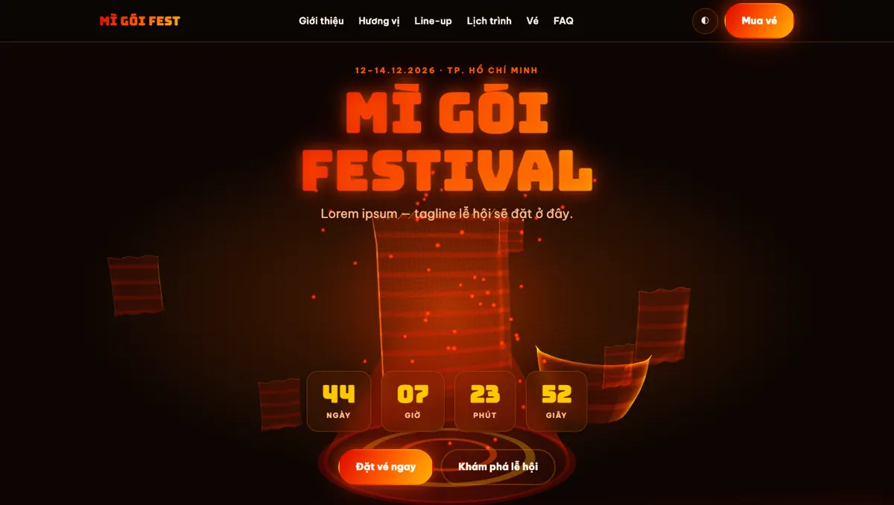
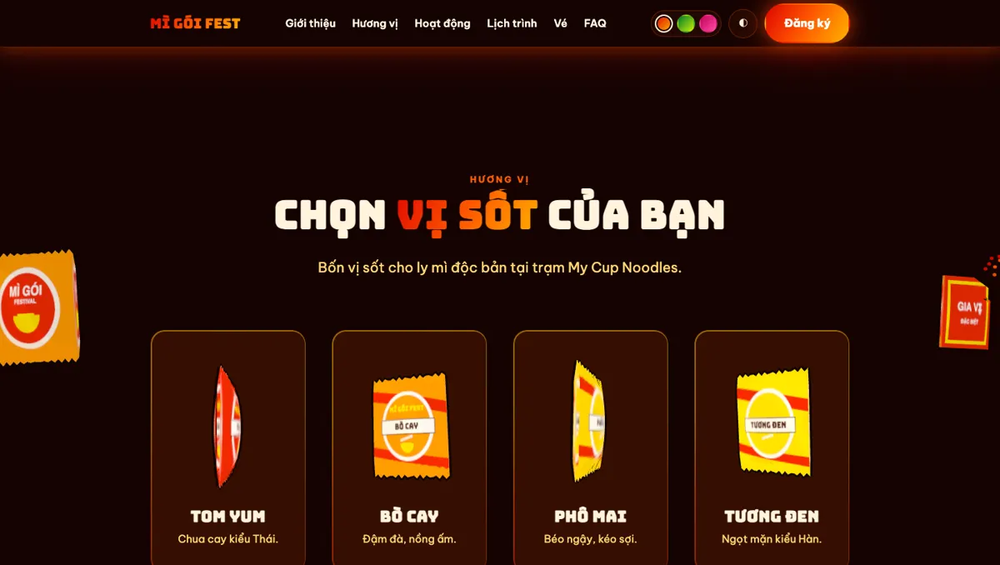
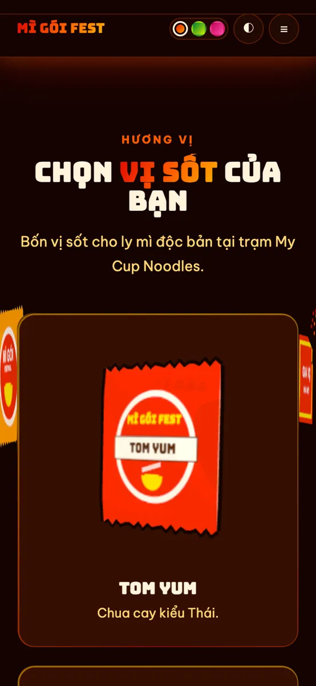
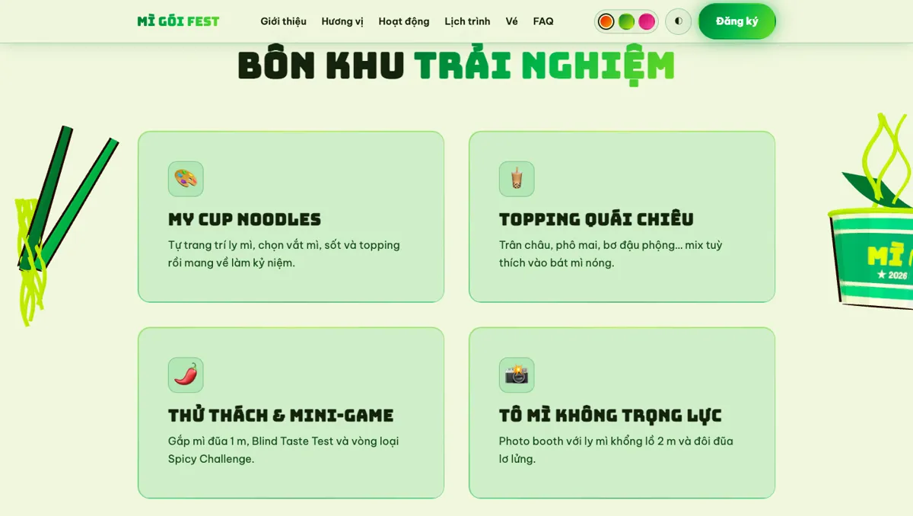
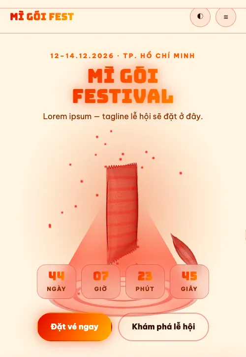
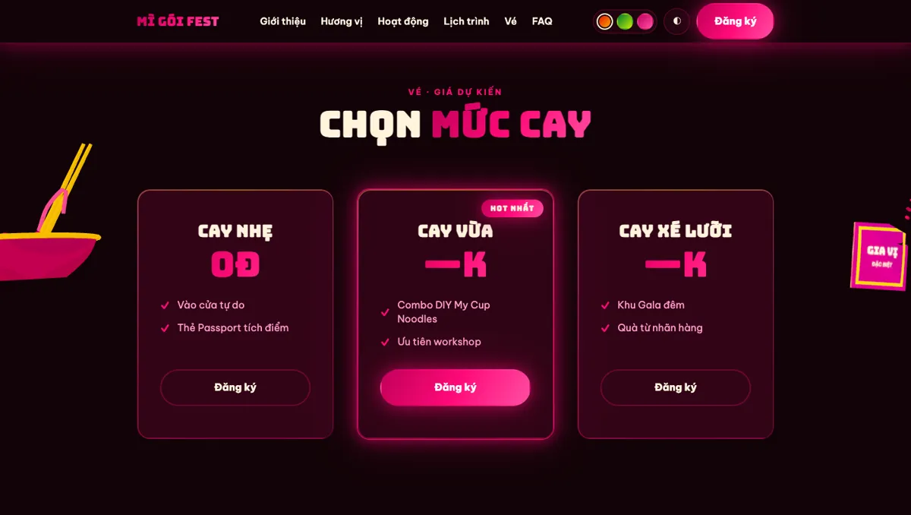

<div align="center">

# 🍜 MÌ GÓI FESTIVAL

### Unbox Your Noodle World — *Mì Gì Cũng Được!*

Landing page demo cho lễ hội trải nghiệm mì gói · 16.12.2026 · ĐH Hoa Sen – Thành Thái

**[▶ Xem demo trực tiếp](https://musual-moncra.github.io/NoodleFestival.github.io/)**




</div>

> [!NOTE]
> Đây là **bản demo bố cục** để khách hàng duyệt. Giá vé, một số câu FAQ và toàn bộ ảnh trong mục
> “Không gian lễ hội” là nội dung tạm, cần thay trước khi phát hành chính thức.

---

## ✨ Điểm nhấn

| | |
|---|---|
| **Hero 3D** | Ly mì Cung Đình trên đế chiếu hologram, 4 sản phẩm thật vây quanh; chữ bên trái, sân khấu bên phải. |
| **Model 3D sản phẩm thật** | Ly, gói, tô mì dựng từ ảnh bao bì thật; mỗi section có một khung model lớn xen kẽ trái/phải, mờ dần hiện ra và biến mất theo cuộn. |
| **Gói mì 3D theo vị** | Mỗi thẻ “Hương vị” là một gói mì 3D in nhãn Tom Yum / Bò Cay / Phô Mai / Tương Đen. |
| **Sáng / tối** | Tự theo cài đặt máy, có nút đổi và nhớ lựa chọn. |
| **3 màu chủ đạo** | Cam (mặc định) · Xanh lá · Hồng — đổi toàn bộ giao diện lẫn model 3D. |
| **Chạy mọi nơi** | Mở thẳng `index.html` (file://) hoặc qua GitHub Pages; responsive tới 375px. |

## 🖼️ Ảnh chụp

<table>
  <tr>
    <td width="60%"></td>
    <td></td>
  </tr>
  <tr>
    <td><sub>Mục “Hương vị” — gói mì 3D trong thẻ, model hai bên</sub></td>
    <td><sub>Mobile 375px</sub></td>
  </tr>
  <tr>
    <td></td>
    <td></td>
  </tr>
  <tr>
    <td><sub>Bảng màu xanh lá · chế độ sáng</sub></td>
    <td><sub>Hero · chế độ sáng · mobile</sub></td>
  </tr>
  <tr>
    <td colspan="2"></td>
  </tr>
  <tr>
    <td colspan="2"><sub>Bảng màu hồng · chế độ tối</sub></td>
  </tr>
</table>

## 🚀 Chạy thử

Không cần cài đặt gì — mở `index.html` bằng trình duyệt là chạy.

Hoặc chạy qua server cục bộ:

```bash
python3 -m http.server 5173
# mở http://localhost:5173
```

## 🗂️ Cấu trúc

```
index.html            Khung trang + nội dung
css/
  base.css            Token màu, 3 bảng màu, sáng/tối, header, hero, khoảng cách
  sections.css        Bố cục các section bên dưới hero
  holo.css            Hiệu ứng thẻ hologram (nghiêng, vệt sáng, scanline)
js/
  ui.js               Đổi theme & màu, menu mobile, đếm ngược, hiệu ứng hiện khi cuộn
  hero3d.js           Hologram 3D ở hero
  side3d.js           Model 3D hai bên theo cuộn
  packs3d.js          Gói mì 3D trong thẻ “Hương vị”
  main.js             Điểm vào bundle
  app.bundle.js       ⚙️ Bản build (three.js + 3 file 3D) — trang chỉ nạp file này
assets/img/           Ảnh mục “Không gian lễ hội”
tools/                Cấu hình build (esbuild)
```

## 🛠️ Sửa phần 3D

`index.html` chỉ nạp `js/app.bundle.js` để trang chạy được cả khi mở bằng `file://`.
Sau khi sửa `hero3d.js`, `side3d.js` hoặc `packs3d.js`, build lại:

```bash
cd tools
npm install      # lần đầu
npm run build    # cập nhật js/app.bundle.js
```

`css/*`, `js/ui.js` và `index.html` sửa trực tiếp, không cần build.

## 🎨 Tùy biến nhanh

| Muốn đổi | Sửa ở đâu |
|---|---|
| Màu của một bảng màu | `css/base.css` → khối `:root[data-palette="…"]` (4 màu từ đậm → sáng) |
| Bảng màu mặc định | `index.html` → script trong `<head>` (`p = 'orange'`) |
| Ngày đếm ngược | `index.html` → `data-countdown="2026-12-16T08:00:00+07:00"` |
| Model 3D của section | `index.html` → `.product-slot` `data-products="chính phụ"` (`cup` · `pack` · `bowl` · `sachet` · `brick` · `chopsticks`) |
| Ảnh “Không gian lễ hội” | Chép đè vào `assets/img/`, giữ nguyên tên file |

## 📦 Triển khai

Repo phát hành bằng **GitHub Pages** từ nhánh `main` (thư mục gốc). Mỗi lần `git push`, trang tự cập nhật sau khoảng 1 phút.

## ⚠️ Trước khi phát hành chính thức

- [ ] Thay 3 ảnh trong `assets/img/` bằng ảnh có quyền sử dụng (ảnh hiện tại là ảnh tham khảo, có logo thương hiệu và người thật)
- [ ] Chốt giá vé và nội dung FAQ còn để trống
- [ ] Gắn link đăng ký và mạng xã hội thật ở nút “Đăng ký” và footer

---

<div align="center"><sub>Thiết kế & phát triển với Claude Code cùng nhóm agent trong MXterm Pro Control Room.</sub></div>
