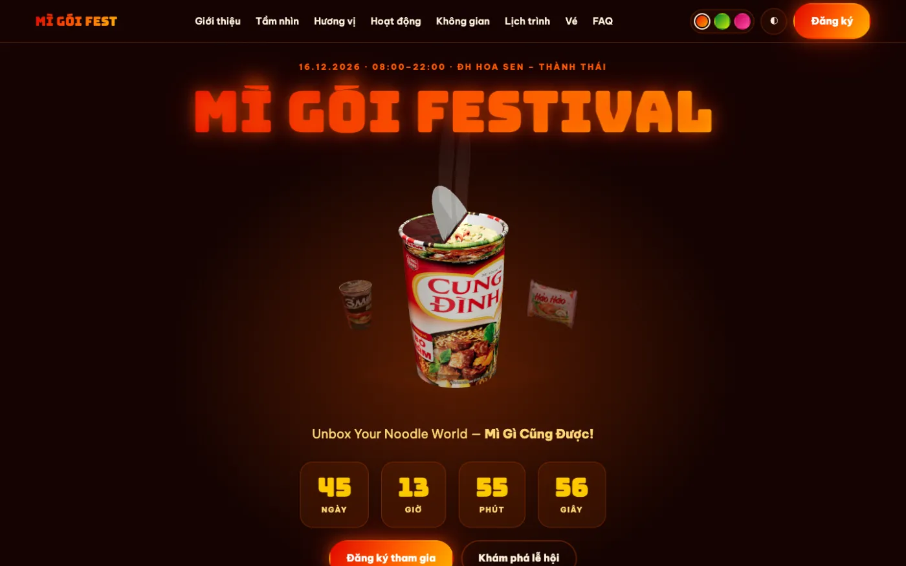
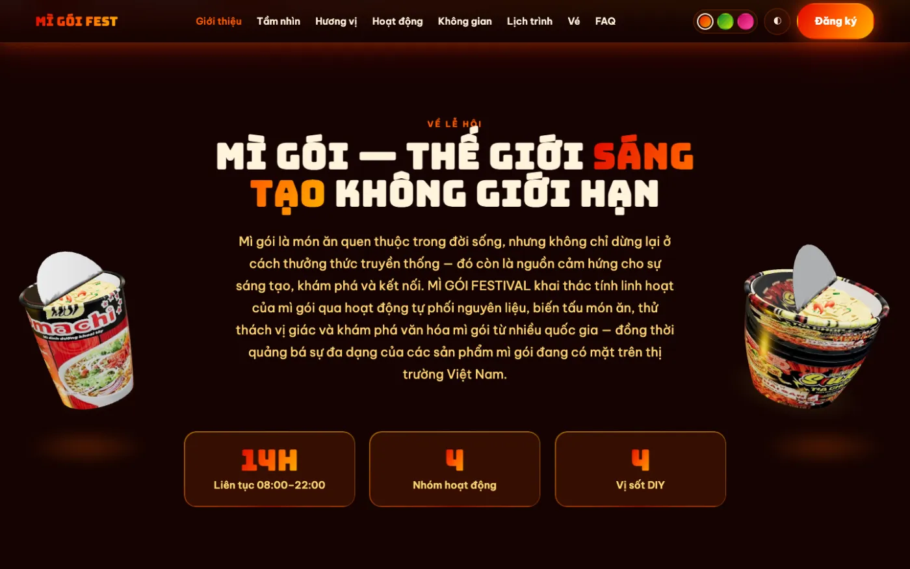
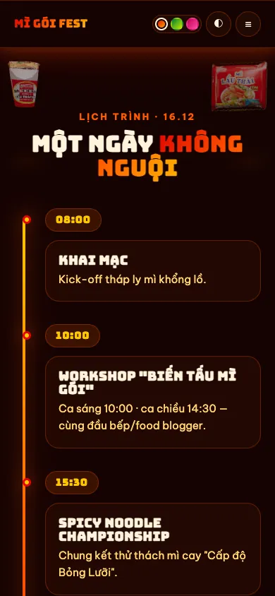
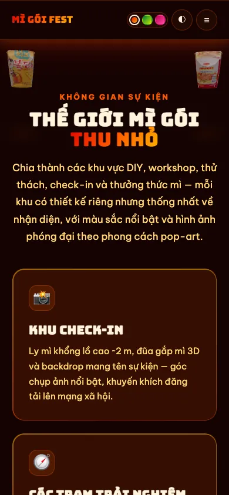

<div align="center">

# 🍜 MÌ GÓI FESTIVAL

### Unbox Your Noodle World — *Mì Gì Cũng Được!*

Landing page demo cho lễ hội trải nghiệm mì gói · 16.12.2026 · ĐH Hoa Sen – Thành Thái

**[▶ Xem demo trực tiếp](https://musual-moncra.github.io/NoodleFestival.github.io/)**




</div>

> [!NOTE]
> Đây là **bản demo bố cục** để khách hàng duyệt. Giá vé (đang ghi “Sắp công bố”) và toàn bộ ảnh
> trong mục “Hình ảnh” là nội dung tạm, cần thay trước khi phát hành chính thức.

---

## ✨ Điểm nhấn

| | |
|---|---|
| **Hero căn giữa** | Tên “MÌ GÓI FESTIVAL” trên cùng, ngay dưới là ly mì 3D lớn ở giữa (nắp foil bóc dở lộ sợi mì + topping, hơi nước), rồi tới đếm ngược và nút đăng ký. |
| **Model 3D sản phẩm thật** | Ly/gói/tô mì dựng từ ảnh bao bì thật: nhãn quấn 360° theo tỉ lệ thật, viền mép cuộn, vật liệu giấy phủ lớp bóng nhẹ. |
| **Model hai bên theo section** | Mỗi section có 2 khung model ở hai lề (`.product-slot`), mờ dần hiện ra khi vào màn hình và biến mất khi rời. |
| **Nội dung từ tài liệu khách** | Concept, theme, tầm nhìn–sứ mệnh–mục tiêu (#mission), 4 nhóm hoạt động, khu vực sự kiện (#zones), lịch trình, FAQ — chỗ chưa chốt ghi “Sắp công bố”, không bịa giá. |
| **Gói mì 3D theo vị** | Mỗi thẻ “Hương vị” là một gói mì 3D in nhãn Tom Yum / Bò Cay / Phô Mai / Tương Đen. |
| **Sáng / tối** | Tự theo cài đặt máy, có nút đổi và nhớ lựa chọn. |
| **3 màu chủ đạo** | Cam (mặc định) · Xanh lá · Hồng — đổi toàn bộ giao diện lẫn model 3D. |
| **Responsive 360 → 2560** | Typography/khoảng cách scale bằng `clamp()`, không scroll ngang; mobile model hai bên thu về 2 góc, không che chữ. |
| **Chạy mọi nơi** | Mở thẳng `index.html` (file://) hoặc qua GitHub Pages. |

## 🖼️ Ảnh chụp

<table>
  <tr>
    <td width="60%"></td>
    <td></td>
  </tr>
  <tr>
    <td><sub>Mục “Giới thiệu” — model hai bên lề, nội dung căn giữa</sub></td>
    <td><sub>Hero · mobile 390px</sub></td>
  </tr>
  <tr>
    <td></td>
    <td></td>
  </tr>
  <tr>
    <td><sub>Lịch trình · mobile 390px</sub></td>
    <td><sub>Khu vực sự kiện · mobile 390px</sub></td>
  </tr>
</table>

## 🚀 Chạy thử

Không cần cài đặt gì — mở `index.html` bằng trình duyệt là chạy.

Hoặc chạy qua server cục bộ:

```bash
python3 -m http.server 5173
# mở http://localhost:5173
```

### Kiểm thử tự động

```bash
python3 tools/verify_v7.py
```

Chụp toàn bộ section ở 6 viewport (360 · 390 · 768 · 1024 · 1440 · 1920) qua cả `file://` và
`http://`, bắt console error, kiểm scroll ngang và `.product-slot` có rect 0 — ảnh lưu vào
`docs/shots/v7-<section>-<width>.png`. In `KẾT QUẢ: PASS` khi sạch.

## 🗂️ Cấu trúc

```
index.html                 Khung trang + nội dung (DOM contract: .hero-stage, .product-slot)
css/
  base.css                 Token màu, 3 bảng màu, sáng/tối, header, hero căn giữa
  sections.css             Bố cục section + .product-slot hai lề, responsive
  holo.css                 Hiệu ứng thẻ hologram (nghiêng, vệt sáng, scanline)
js/
  ui.js                    Đổi theme & màu, menu mobile, đếm ngược, scrollspy, reveal khi cuộn
  hero3d.js                Ly mì 3D lớn ở hero, fit vào .hero-stage
  side3d.js                Model 3D hai bên theo cuộn, đọc .product-slot[data-products]
  packs3d.js               Gói mì 3D trong thẻ “Hương vị”
  product-models.js        Dựng model thật: nhãn quấn, nắp foil bóc, mì xoăn + topping, hơi nước
  products-data.js         ⚙️ Sinh tự động: dữ liệu 15 sản phẩm (từ assets/products)
  products-textures.js     ⚙️ Sinh tự động: texture nhúng data-URI cho file://
  main.js                  Điểm vào bundle
  app.bundle.js            ⚙️ Bản build (three.js + các file 3D) — trang chỉ nạp file này
assets/img/                Ảnh mục “Hình ảnh”
tools/
  prepare_products.py      Sinh js/products-data.js từ ảnh sản phẩm
  embed_textures.py        Nhúng texture vào js/products-textures.js cho file://
  verify_v7.py             QA: chụp 6 viewport, console error, scroll ngang, slot
```

## 🛠️ Sửa phần 3D

`index.html` chỉ nạp `js/app.bundle.js` để trang chạy được cả khi mở bằng `file://`.
Sau khi sửa `hero3d.js`, `side3d.js`, `packs3d.js` hoặc `product-models.js`, build lại:

```bash
cd tools
npm install      # lần đầu
npm run build    # cập nhật js/app.bundle.js
```

Đổi/sửa dữ liệu hay ảnh sản phẩm trong `assets/products/`:

```bash
cd tools
python3 prepare_products.py && python3 embed_textures.py
```

`css/*`, `js/ui.js` và `index.html` sửa trực tiếp, không cần build.

## 🎨 Tùy biến nhanh

| Muốn đổi | Sửa ở đâu |
|---|---|
| Màu của một bảng màu | `css/base.css` → khối `:root[data-palette="…"]` (4 màu từ đậm → sáng) |
| Bảng màu mặc định | `index.html` → script trong `<head>` (`p = 'orange'`) |
| Ngày đếm ngược | `index.html` → `data-countdown="2026-12-16T08:00:00+07:00"` |
| Model 3D của section | `index.html` → `.product-slot` `data-products="chính phụ"` (`cup` · `pack` · `bowl` · `sachet`) |
| Ảnh “Hình ảnh” | Chép đè vào `assets/img/`, giữ nguyên tên file |

## 📦 Triển khai

Repo phát hành bằng **GitHub Pages** từ nhánh `main` (thư mục gốc). Mỗi lần `git push`, trang tự cập nhật sau khoảng 1 phút.

## ⚠️ Trước khi phát hành chính thức

- [ ] Thay 3 ảnh trong `assets/img/` bằng ảnh có quyền sử dụng (ảnh hiện tại là ảnh tham khảo, có logo thương hiệu và người thật)
- [ ] Chốt giá vé và nội dung FAQ còn ghi “Sắp công bố”
- [ ] Gắn link đăng ký và mạng xã hội thật ở nút “Đăng ký” và footer

---

<div align="center"><sub>Thiết kế & phát triển với Claude Code cùng nhóm agent trong MXterm Pro Control Room.</sub></div>
